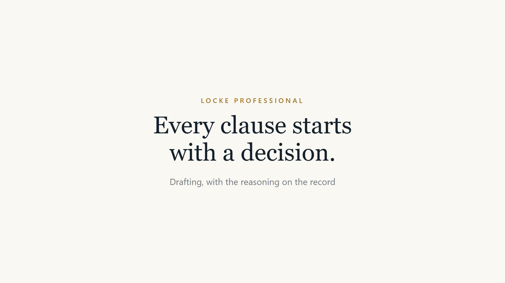

# LOCKE PROFESSIONAL
### Every clause starts with a decision. Every decision stays on the record.

**Product engineering portfolio by Locke Development · November 13, 2026**  
For engineering employers, legal-tech partners and organizations seeking applied AI, product architecture or workflow automation expertise.

[**Explore the deployed platform**](https://lockeprofessional.com/) · [**See the narrated product demo**](https://lockeprofessional.com/guided-demo/locke-professional-demo.mp4) · [**Compare five CLM leaders**](COMPARISON.md)

---

## The challenge

Legal work is rarely a blank-page writing problem. The hard part is deciding **whose interests the document should protect, what risks can be accepted, what the counterparty is likely to resist, and why specific language belongs in the agreement**.

Locke Professional is built around these decisions. Its guided drafting turns material issues into explicit choices, then passes those decisions into governed document assembly and the wider contract record.

> **Product principle:** Drafting is a sequence of accountable legal and commercial choices, not an uncontrolled prompt-to-prose operation.

## Six product capabilities that demonstrate engineering depth

| 01 / **Decision-led drafting** | Identifies material issues, party posture, recommended positions, alternatives, risk consequences, and saves the attorney's decisions |
|---|---|
| 02 / **Substantive contract review** | Source-linked findings, disposition and exception workflows, reviewer assignment, comments, completion checks, document comparison |
| 03 / **Ask Locke in context** | Stage-aware help, valid library/template recommendations, contract-grounded Q&A, canonical fact seeding and explicit excerpt-coverage limits |
| 04 / **Governed document architecture** | Published-pack clearance, clause/rule selection, questionnaires, legal-domain specialization, assembly protections and multi-format outputs |
| 05 / **Lifecycle and governance** | Organization-bound repository, approval separation, signed-artifact integrity, signing ledger, obligation extraction, scoped access |
| 06 / **Extendable engineering platform** | React/TypeScript interface, Express/PostgreSQL services, AI gateway, Word add-in, read-only API keys, signed webhooks and domain adapters |

## The workflow

**Describe → Identify the issues → Decide the position → Assemble → Review and negotiate → Approve and execute → Track obligations.**

The current code contains all these major areas, but this portfolio **does not represent every component as fully certified**: renewal holiday handling, external intake certification, outbound delivery and reporting certification remain incomplete in the repository's own status audit.

## Ask Locke: the assistant does more than answer questions

Ask Locke recognizes where a user is in the product, guides them toward **real templates**, carries permitted deal facts into matching questionnaire variables, and can answer questions about an existing agreement. When the supplied excerpt represents only part of the contract, it **says so in the answer** rather than asserting that unseen language is absent.

This provides a concrete example of **context-aware AI integration with transparent limits**, not an unstructured chat box pretending to make legal judgments.

**[Read the 30-behavior Ask Locke examination](ASK-LOCKE.md)**

## Why it stands apart as portfolio work

The achievement is the engineering **composition**: a front-end explanation experience supported by issue registries, decision history, domain libraries, application validation, review evidence, approved state transitions, document integrity, and external integration controls.

Ironclad, Icertis, Agiloft, LinkSquares and Juro have major commercial strengths and sophisticated AI; this portfolio examines and acknowledges them. Locke's distinctive implementation emphasizes **explicit, traceable contract decisions** rather than only document text and workflow status.

**[View the 45-row side-by-side comparison](COMPARISON.md)** · **[Inspect every catalogued feature](FEATURE-MATRIX.md)**

## A visible release, not a conceptual mockup

The inspected code was deployed successfully to Railway from the private release branch at commit 590032c66a12. The repository declares 24 tracked capability families, with 18 complete, four incomplete, one internal and one commercial decision pending. Those qualifications are part of the portfolio record.

**Site-published catalogue:** nine production libraries, 99 attorney-review-ready templates; the private registry lists 13 registered packs, which are not automatically publishable. Pricing is consultation-based; internal modeling amounts are not quoted to prospects.

## Watch the source demonstration

[**Watch the official demonstration**](https://lockeprofessional.com/guided-demo/locke-professional-demo.mp4) · [**Open the guided tour**](https://lockeprofessional.com/guided-demo.html)

---

**For prospective development clients:** evidence of product and workflow architecture, bounded AI calls, role-aware permissions, durable state, integration work and release operations.

**For prospective employers:** evidence of building and evolving a real multi-module platform across frontend, backend, database, AI, document operations and deployment.

[**Live product**](https://lockeprofessional.com/) · [**Technical source map**](ROUTE-TRACE.md) · [**Limitations and methodology**](METHODOLOGY.md)

*Locke Professional is not a law firm and does not provide legal advice. This brochure is a software portfolio, not a clinical or legal quality certification.*
