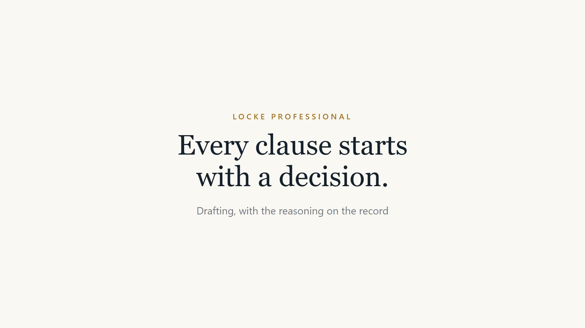

# Locke Professional — Original website demonstration

**[Play the ~98-second narrated demonstration (MP4)](https://lockeprofessional.com/guided-demo/locke-professional-demo.mp4)**

**[Take the interactive guided tour](https://lockeprofessional.com/guided-demo.html)** · **[Live product](https://lockeprofessional.com/)**

The official product homepage embeds this video from its own /guided-demo/ directory and describes the walkthrough as an attorney drafting a software agreement from a plain-English deal brief to an explicit decision ledger. The sample involves a freight business purchasing routing software; the film walks through party posture, liability cap alternatives, AI training rights, and recording counsel's choices.

This public repository includes the original preview image. The MP4 is **linked from the website rather than duplicated**, preventing a second out-of-date video file from diverging from the live version.

[Portfolio brochure](BROCHURE.md) · [Full feature matrix](FEATURE-MATRIX.md)
