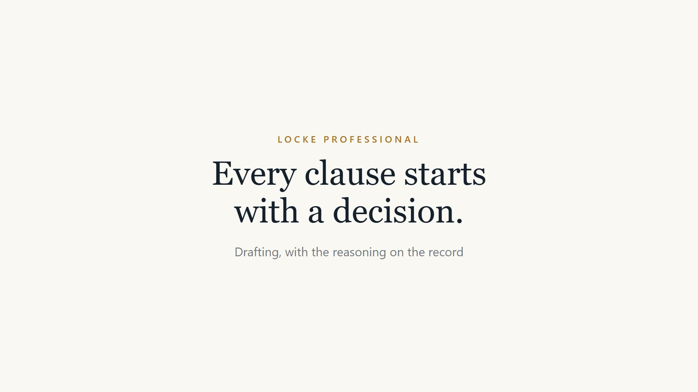

<h1 align="center">LOCKE PROFESSIONAL</h1>

<strong>Every clause starts with a decision. Every decision stays on the record.</strong>

<em>A deployed product engineering portfolio from Locke Development.</em>

<a href="https://lockeprofessional.com/">Live product</a> ·
<a href="BROCHURE.md">Portfolio brochure</a> ·
<a href="COMPARISON.md">Competitor comparison</a> ·
<a href="FEATURE-MATRIX.md">361-feature audit</a> ·
<a href="ASK-LOCKE.md">Ask Locke</a> ·
<a href="DEMO.md">Official demo</a>

---

## A complete product story, backed by inspectable evidence

**Locke Professional** is an attorney-oriented contract workspace that combines guided decision-making, governed clause drafting, document review, negotiation, approval, electronic signing, executed records, and post-signature obligation management.

The distinguishing concept is **decision-led drafting**. Instead of merely generating clauses, the system surfaces the issues that must be decided, recommends a defensible position for the represented party, describes alternatives and their consequences, and records the attorney's decision on the matter. The final agreement is assembled from governed content under application rules, with the attorney retaining control.

This public repository is for **prospective software-development clients and employers** assessing real engineering capability, not a pitch claiming every rival CLM platform lacks these features.

## See the product

[**Watch the official ~98-second demonstration**](https://lockeprofessional.com/guided-demo/locke-professional-demo.mp4) · [**Open the interactive guided tour**](https://lockeprofessional.com/guided-demo.html)

The poster is included here; the original MP4 remains served from the official product site.

## What the implementation demonstrates

| Product surface | What the engineering proves |
|---|---|
| **Guided drafting** | Party posture, rule-triggered issue cards, alternative positions, load-bearing warnings and a persistent attorney decision ledger |
| **Contract review and negotiation** | Source-linked findings, issue dispositions, reviewer assignment, comments, exceptions and version comparison |
| **Ask Locke** | Stage-aware natural-language navigation, real-template recommendation, fact seeding, contract Q&A and transparent document-coverage warnings |
| **Governed legal libraries** | Registered domain packs, production-clearance controls, validated questionnaires and deterministic document assembly |
| **Full contract lifecycle** | Repository, approvals tied to current document text, signing, executed artifacts, obligations and notices; incomplete paths identified openly |
| **Document operations** | PDF/DOCX ingestion, scanned-page OCR, artifact integrity and exports in multiple formats |
| **Platform integration** | Word add-in, read-only API keys, signed webhooks, organization scoping and auditable access decisions |

### How thoroughly was it compared?

<strong>Feature-by-feature evidence, not a module-level checklist</strong>

- **361 atomic capabilities** catalogued in 24 functional sections, each tied to source files and compared at a documented level against five CLM vendors.
- **203 individual API route operations** indexed across 25 inspected modules.
- **30 Ask Locke behaviors** reviewed individually.
- **45 market-significant capabilities** compared in a separate, readable side-by-side table.
- **Every one of 24 tracked release capability statuses** retained as complete, incomplete, internal or pending.

[Full feature register](FEATURE-MATRIX.md) · [Route-operation register](ROUTE-TRACE.md) · [Exact status audit](CAPABILITY-STATUS.md)

## Competitive context

The five comparators are **Ironclad, Icertis, Agiloft, LinkSquares and Juro**. All offer sophisticated AI-enabled contract management, and the comparison credits those capabilities.

**[Read the evidence-based comparison →](COMPARISON.md)**

## Product packaging and visibility

The current public website identifies **Professional, Professional Firm and Professional Enterprise**, with pricing discussed by inquiry. It advertises **9 production libraries and 99 templates ready for attorney review**. The private registry contains **13 registered packs**; registration and production clearance are different states, and this portfolio does not turn unreleased content into a sales claim.

**Implementation status matters:** the repository's own 24-area audit reports 18 complete, four incomplete, one internal and one awaiting a commercial decision. In particular, renewals, external intake, outbound email and reporting certification have outstanding work; live subscription checkout is not established.

## Technical implementation

The deployed source is Node.js/Express and PostgreSQL, with a React/TypeScript operator interface, governed clause libraries, AI provider routing, multi-tenant access controls, integration surfaces and three specialized domain-service adapters. The private production code remains private; this repository contains only public summaries, source evidence references and brand assets.

[**Portfolio brochure**](BROCHURE.md) · [**Ask Locke**](ASK-LOCKE.md) · [**Library coverage**](LIBRARIES.md) · [**Methodology**](METHODOLOGY.md) · [**Visual presentation**](index.html)

---

Locke Professional provides drafting support and contract-management technology, not legal advice or representation. No independently verified legal superiority, AI accuracy advantage, security ranking or end-to-end commercial-readiness claim is made.
